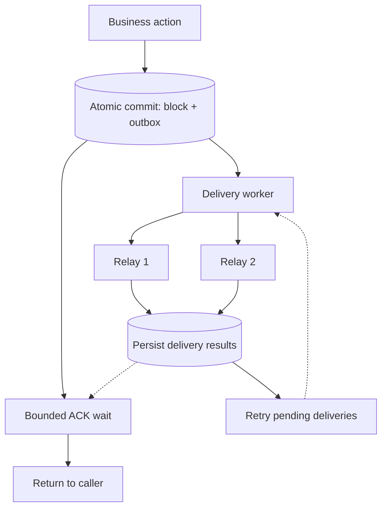
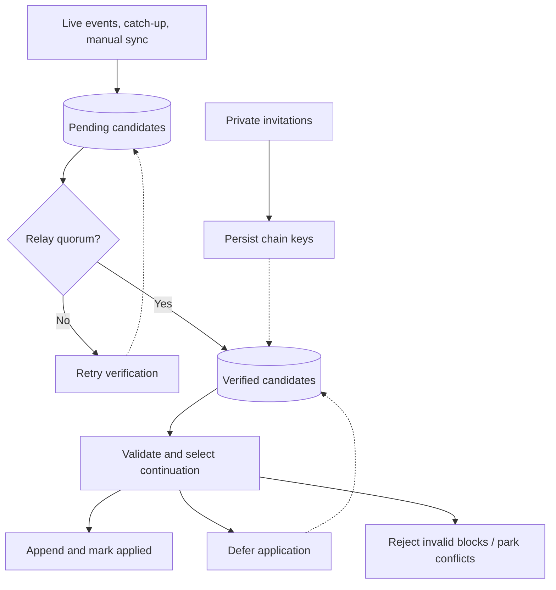
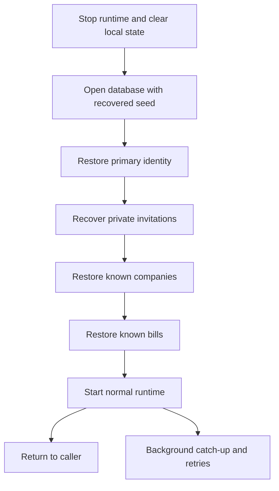

# Nostr Propagation and Recovery

Bitcredit distributes signed bill, company and identity blocks over Nostr. Durable queues separate local business transactions from network delivery. Live events, historical catch-up and restoration use the same incoming validation pipeline.

## 1. Outgoing: commit first, deliver asynchronously

The block and its signed public events are committed atomically. Delivery runs in the background. The caller waits briefly for the initial ACK threshold (normally one per required message), or a timeout, rather than waiting for every relay. Unfinished deliveries are retried using the same signed events, preserving predecessor order on each relay.

**An ACK is not quorum.** With two configured relays, one ACK per required message can end the initial wait, but recipients need availability on both relays. Public-chain quorum is a strict majority of distinct configured relays; outgoing group quorum requires a common majority for all its public events. Private invites do not count towards that group quorum. Stored ACKs record past acceptance, not current availability.

## 2. Incoming: verify before applying

The recipient checks availability of the exact signed event independently against its saved relay snapshot. Quorum alone does not authorize a block: chain keys, predecessor, integrity and protocol rules must also pass.

Valid bill and company events may arrive before their keys. Invitations persist the keys and wake waiting candidates. Foreign identity chains and invalid chain IDs are ignored at live receipt. New work wakes the worker promptly; retry backoff and periodic scans cover failures.

Among competing known, verified extensions, the best protocol-valid continuation is preferred. Normal application never replaces committed history. Invalid data is rejected; conflicting forks are parked; temporary failures remain retryable. Replays are idempotent and repair required bookkeeping. Unreadable local queue rows are deferred without blocking unrelated chains.

## 3. Catch-up and restoration

Restore is a one-shot operation into a fresh database, using the recovered mnemonic from the beginning. The foreground pass restores currently discoverable, quorum-verified and applicable chains before returning. Companies are restored before bills because company history can reveal additional bill keys.

Unresolved events remain queued for background recovery. Public and private catch-up use per-relay historical scans with persistent cursors, not just the latest timestamp. Ordinary restart preserves the database and resumes pending work; it does not clear or restore it.

## Guarantees and limits

- Durable, at-least-once delivery attempts and idempotent block application.
- Availability quorum, **not consensus, finality or permanent relay retention**.
- Append-only normal synchronization; developer-authoritative overrides are exceptional.
- Private invitation recovery relies on relay retention until successful processing. Contacts, file metadata and notifications are best-effort.
- No guarantee of recovering unpublished data, permanently missing history or arbitrary local corruption. Reset and destructive restoration must be serialized by the caller - complete outgoing-worker quiescence on reset is not guaranteed.
